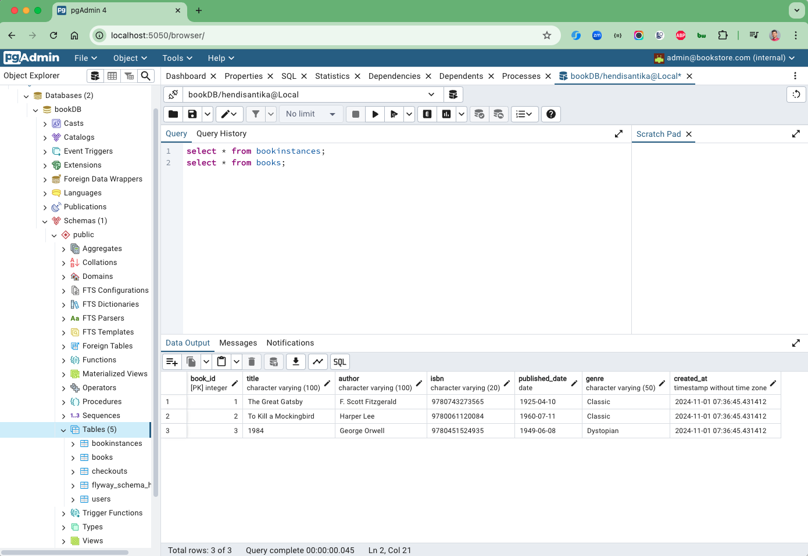
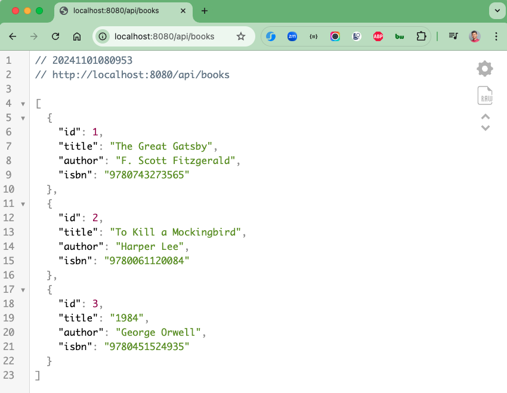
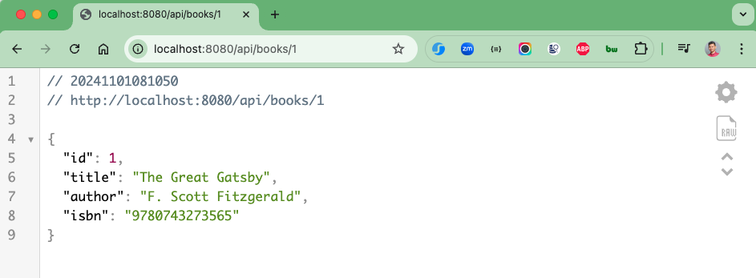

# spring-boot-books

[](https://github.com/hendisantika/spring-boot-books/actions/workflows/gradle.yml)


Simple Book Store REST API built with Spring Boot, Spring Data JPA, Flyway and PostgreSQL.

## Tech Stack

| Component       | Version / Tool                                   |
|-----------------|--------------------------------------------------|
| Java            | 25 (Gradle toolchain)                            |
| Spring Boot     | 4.1.2 (Web MVC, Data JPA, Flyway, Docker Compose) |
| Build tool      | Gradle 9.8.2 (wrapper included)                  |
| Database        | PostgreSQL 17 + Flyway 13 migrations             |
| Testing         | JUnit 5, Testcontainers 2, REST Assured 6        |
| Container       | Docker (`gradle:jdk25` → `amazoncorretto:25`)    |

## Prerequisites

- JDK 25 (e.g. [Temurin](https://adoptium.net/) or [Amazon Corretto](https://aws.amazon.com/corretto/))
- Docker & Docker Compose (for PostgreSQL, pgAdmin and Testcontainers)

## Things todo list

1. Clone this repository: `git clone https://github.com/hendisantika/spring-boot-books.git`
2. Navigate to the folder: `cd spring-boot-books`
3. Run the application: `./gradlew bootRun`
   - `spring-boot-docker-compose` automatically starts PostgreSQL & pgAdmin from `compose.yaml`
   - Flyway applies the migrations in `src/main/resources/db/migration`
4. Open pgAdmin: http://localhost:5050 (`admin@bookstore.com` / `bookstoreadmin`)
5. List all books: http://localhost:8080/api/books
6. Find a book by id: http://localhost:8080/api/books/{id}

## API Endpoints

| Method | Path              | Description        |
|--------|-------------------|--------------------|
| GET    | `/api/books`      | Get all books      |
| GET    | `/api/books/{id}` | Get a book by id   |

## Build & Test

```shell
# Compile, run tests (Testcontainers needs a running Docker daemon) and package the jar
./gradlew build

# Run tests only
./gradlew test
```

## Docker

```shell
docker build -t spring-boot-books .
docker compose up -d   # PostgreSQL 17 + pgAdmin
docker run --rm -p 8080:8080 \
  -e SPRING_DATASOURCE_URL=jdbc:postgresql://host.docker.internal:5432/bookDB \
  spring-boot-books
```

## CI/CD & Dependency Updates

- **GitHub Actions** (`.github/workflows/gradle.yml`): builds and tests with JDK 25 (Temurin) on every push and pull
  request to `main`, and submits the dependency graph for Dependabot alerts.
- **Dependabot** (`.github/dependabot.yml`):
  - Gradle dependencies — daily, grouped (Spring Boot, Flyway, Testcontainers, test libraries, minor & patch)
  - GitHub Actions — weekly, grouped
  - Dockerfile & `compose.yaml` images — weekly (Dockerfile stays on the JDK 25 line)

## Image Screenshot

PgAdmin Page



List Books Page



Find Book by Id


